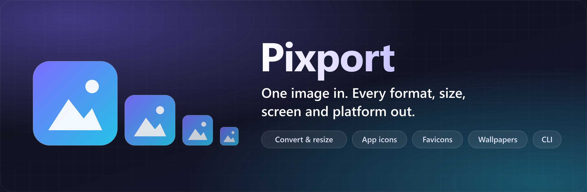
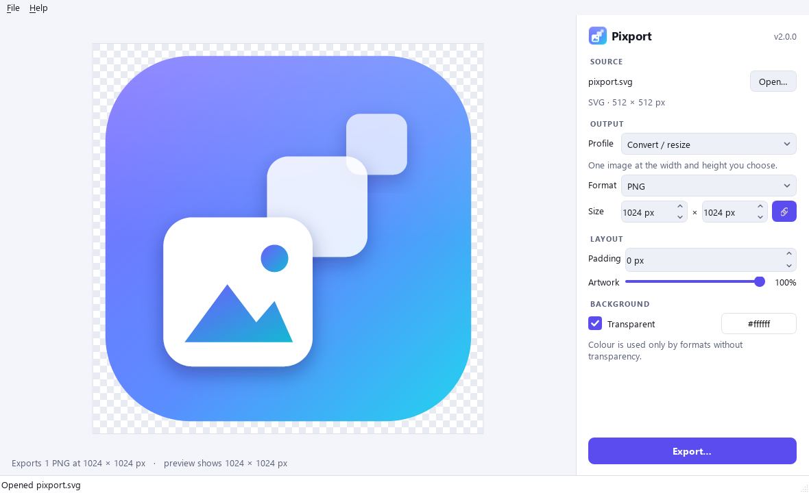
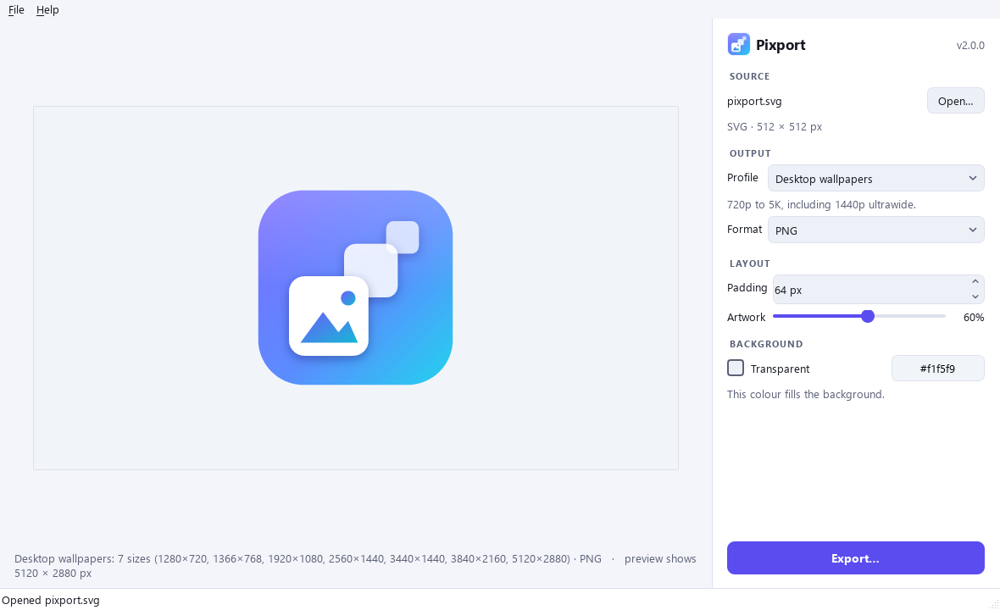

<p align="center">
  
</p>

<p align="center">
  <a href="https://github.com/RandyNorthrup/pixport/releases/latest"></a>
  <a href="https://github.com/RandyNorthrup/pixport/releases"></a>
  <a href="https://github.com/RandyNorthrup/pixport/actions/workflows/ci.yml"></a>
  
  
  <a href="LICENSE"></a>
  <a href="https://github.com/sponsors/RandyNorthrup"></a>
</p>

<p align="center">
  <b>Pixport</b> turns one SVG or image into whatever you need next: a resized PNG, JPG, WEBP, TIFF or PDF,<br>
  a Windows <code>.ico</code>, a macOS <code>.icns</code>, drop-in icon sets for Linux, Android, iOS and websites,<br>
  or wallpapers for every common desktop, phone and tablet screen. Desktop app and command line.
</p>

<p align="center">
  <a href="https://github.com/RandyNorthrup/pixport/releases/latest"><b>Download</b></a> ·
  <a href="#export-profiles">Profiles</a> ·
  <a href="#command-line">Command line</a> ·
  <a href="#how-artwork-is-placed">How placement works</a> ·
  <a href="CHANGELOG.md">Changelog</a> ·
  <a href="CONTRIBUTING.md">Contributing</a>
</p>

<p align="center">
  <picture>
    <source media="(prefers-color-scheme: dark)" srcset="docs/assets/screens/convert-dark.png">
    
  </picture>
</p>

## What it does

- **Convert and resize** any SVG, SVGZ, PNG, JPG, WEBP, BMP, GIF, TIFF or ICO to PNG, JPG, WEBP, BMP, TIFF or PDF at any size up to 16384 px, with the aspect ratio locked or free.
- **App icons for every platform in one click**: a multi-size Windows `.ico`, a macOS `.icns`, a Linux `hicolor` icon theme, Android adaptive, round and legacy launcher icons with the Play Store icon, and an Xcode `AppIcon.appiconset` with its `Contents.json`.
- **Website favicons**: `favicon.ico`, PNG favicons, `apple-touch-icon.png`, manifest icons, `site.webmanifest` and a ready-to-paste `<head>` snippet.
- **Wallpapers** at 7 desktop, 8 phone and 5 tablet resolutions, portrait and landscape.
- **Every size is rendered on its own.** A 16 px icon is drawn at 16 px from the vector, not shrunk from a 256 px image, so thin lines stay crisp.
- **The preview is the export.** It is drawn by the same code that writes the files, including padding, artwork size, background and formats that cannot be transparent.
- **Nothing is overwritten.** Exporting twice writes `name_1.ico` or `name-android_1/` next to the first result.
- **Light and dark themes** that follow your system, drag and drop, and settings that are remembered between launches.
- **A command line** for build scripts and CI, using the same profiles.
- **No system libraries to install.** SVG is rendered by [resvg](https://github.com/linebender/resvg), which ships inside the Python wheel.

## Download

Grab the file for your system from the [latest release](https://github.com/RandyNorthrup/pixport/releases/latest):

| System | File | Notes |
|---|---|---|
| Windows 10 and 11 (x64) | `Pixport-<version>-windows-x64.exe` | Portable: no installer, run it from anywhere. |
| macOS on Apple silicon | `Pixport-<version>-macos-arm64.dmg` | Drag Pixport to Applications. macOS 12 or later. |
| macOS on Intel | `Pixport-<version>-macos-x64.dmg` | Drag Pixport to Applications. macOS 12 or later. |
| Linux (x64) | `Pixport-<version>-linux-x64.tar.gz` | Extract, then run `./install.sh` for a menu entry, or run `pixport/pixport` directly. |

Every file is listed with its SHA-256 in `SHA256SUMS.txt` on the release page.

**First launch:** the builds are not code-signed (and will not be), so your system will ask before opening them.
On Windows, choose **More info → Run anyway** in the SmartScreen prompt. On macOS 15 and later, open Pixport
once, close the warning, then go to **System Settings → Privacy & Security** and click **Open Anyway**. On macOS 12
to 14, right-click Pixport in Applications, choose **Open**, then **Open** again.

### Install with pip instead

Needs Python 3.11 or later. This gives you both the app and the command line:

```bash
pipx install git+https://github.com/RandyNorthrup/pixport.git
pixport              # open the app (or: pixport-gui)
pixport --help       # command line
```

`pip install git+https://github.com/RandyNorthrup/pixport.git` works too. Pixport is not on PyPI yet.

## Using the app

1. **Open an image**: drop it on the window, click the empty preview, or press <kbd>Ctrl</kbd>+<kbd>O</kbd> (<kbd>⌘</kbd>+<kbd>O</kbd> on macOS). Opening a file with the downloaded app, or running `pixport-gui logo.svg`, loads it straight away.
2. **Pick a profile** and, where there is a choice, a format. The line under the preview lists every size the profile writes.
3. **Adjust the layout**:
   - **Size** (Convert / resize only): the output canvas. The 🔗 button keeps the source's aspect ratio.
   - **Padding**: an empty margin on every side, in pixels at the largest output size. Smaller sizes keep the same proportion.
   - **Artwork**: shrinks the artwork from 100 % (fills the space inside the padding) down to 10 %.
   - **Background**: transparent, or filled with the colour you pick. JPG, BMP and PDF have no transparency, so they always use the colour, as do iOS app icons and `apple-touch-icon.png`.
4. **Export** (<kbd>Ctrl</kbd>+<kbd>E</kbd>) and choose a folder. The export runs in the background with a progress bar and a **Cancel** button; files already written are kept if you cancel. When it finishes, **Show folder** opens the result.

<p align="center">
  <picture>
    <source media="(prefers-color-scheme: dark)" srcset="docs/assets/screens/wallpaper-desktop-dark.png">
    
  </picture>
</p>

## Export profiles

| Profile | ID (command line) | Writes | Sizes (px) | Formats |
|---|---|---|---|---|
| Convert / resize | `convert` | `name_<w>x<h>.<ext>` | the width × height you choose | PNG, JPG, WEBP, BMP, TIFF, PDF |
| Windows icon | `windows-ico` | `name.ico` | 16, 20, 24, 32, 40, 48, 64, 96, 128, 256 | ICO |
| macOS icon | `macos-icns` | `name.icns` | 16, 32, 64, 128, 256, 512, 1024 | ICNS |
| Linux icon theme | `linux` | `name-linux/hicolor/<n>x<n>/apps/name.png`, plus `scalable/apps/name.svg` for SVG sources | 16, 22, 24, 32, 48, 64, 96, 128, 256, 512 | PNG |
| Android launcher icons | `android` | `name-android/` with `mipmap-{mdpi…xxxhdpi}/`, `mipmap-anydpi-v26/`, `values/` and `playstore-icon.png` (details below) | legacy 48 to 192, adaptive layers 108 to 432, 512 for the Play Store | PNG, WEBP |
| iOS / iPadOS app icon | `ios` | `name-ios/AppIcon.appiconset/` with `Icon-<n>.png` and `Contents.json` | 20, 29, 40, 58, 60, 76, 80, 87, 120, 152, 167, 180, 1024 | PNG, always opaque |
| Website favicons | `web` | `name-web/` with the files listed below | 16, 32, 48, 180, 192, 512 | PNG and ICO |
| Desktop wallpapers | `wallpaper-desktop` | `name-wallpapers-desktop/name_<w>x<h>.<ext>` | 1280×720, 1366×768, 1920×1080, 2560×1440, 3440×1440, 3840×2160, 5120×2880 | PNG, JPG, WEBP, BMP |
| Phone wallpapers | `wallpaper-phone` | `name-wallpapers-phone/…` | 750×1334, 1080×1920, 1080×2400, 1170×2532, 1179×2556, 1290×2796, 1440×3040, 1440×3200 | PNG, JPG, WEBP, BMP |
| Tablet wallpapers (portrait) | `wallpaper-tablet-portrait` | `name-wallpapers-tablet-portrait/…` | 1536×2048, 1600×2560, 1640×2360, 1668×2388, 2048×2732 | PNG, JPG, WEBP, BMP |
| Tablet wallpapers (landscape) | `wallpaper-tablet-landscape` | `name-wallpapers-tablet-landscape/…` | 2048×1536, 2560×1600, 2360×1640, 2388×1668, 2732×2048 | PNG, JPG, WEBP, BMP |

`name` is the source file's name without its extension.

**Platform details**

- **macOS `.icns`** holds the same PNG elements Apple's `iconutil` writes: 16 to 512 pt at 1x and Retina (16 to 1024 px), each rendered at its own size.
- **iOS** sets are always opaque because App Store Connect rejects icons with an alpha channel. Transparent areas and padding are filled with the background colour. `Contents.json` lists every iPhone, iPad and App Store slot, so the set works with any Xcode version.
- **Android** output drops into `app/src/main/res/`. Each `mipmap-<density>/` folder holds `ic_launcher` (legacy, 48 dp), `ic_launcher_round` (the artwork on a circle of the background colour), and the adaptive icon layers `ic_launcher_foreground` and `ic_launcher_monochrome` (108 dp; the artwork, corners included, fits inside the 66 dp safe circle that every launcher mask keeps visible; the monochrome layer drives Android 13 themed icons). `mipmap-anydpi-v26/ic_launcher.xml` and `ic_launcher_round.xml` combine the layers, and `values/ic_launcher_background.xml` holds the background colour. Point `android:icon` and `android:roundIcon` at `@mipmap/ic_launcher` and `@mipmap/ic_launcher_round`.
- **Website favicons** contain `favicon.ico` (16, 32, 48), `favicon-16x16.png`, `favicon-32x32.png`, `apple-touch-icon.png` (180, opaque), `icon-192.png`, `icon-512.png`, `site.webmanifest` (named after the file, with the background colour as theme colour), `favicon.svg` when the source is an `.svg`, and `head-snippet.html` with the matching `<link>` tags.
- **PDF** output contains the rendered image at 72 dpi, so the page measures the pixel size in points. Vector paths are not kept.
- **JPG** is written at quality 95 without chroma subsampling, so edges in logos stay clean. **WEBP** is lossless. **TIFF** uses LZW compression.

## How artwork is placed

For every output canvas:

1. **Padding** is reserved on every side. It is set at the largest size the profile writes and scaled for each smaller size, so a 64 px margin at 512 px becomes 2 px at 16 px.
2. The artwork is **scaled to fit** the space left, keeping its aspect ratio. SVGs are rendered at that size; raster images are resampled with Lanczos.
3. **Artwork %** shrinks it further. It never enlarges past the fit.
4. The artwork is **centred** on a transparent canvas, or on the background colour.

## Command line

```bash
# Windows and macOS icons into build/icons
pixport logo.svg -p windows-ico -p macos-icns -o build/icons

# Resize a photo to an 800 × 600 WEBP
pixport photo.png --width 800 --height 600 -f webp

# Android icons as WEBP, plus a Windows .ico (-f applies where the profile supports it)
pixport logo.svg -p android -p windows-ico -f webp

# Phone wallpapers, artwork at 40 % on a dark background
pixport logo.svg -p wallpaper-phone -f jpg --zoom 40 --background "#0f172a"

# Every profile and its formats
pixport --list-profiles
```

| Option | Meaning | Default |
|---|---|---|
| `INPUT …` | One or more source files. With none, the app opens. | |
| `-p`, `--profile ID` | Profile to export; repeat for several. | `convert` |
| `-o`, `--out DIR` | Output folder. | current folder |
| `-f`, `--format FMT` | Output format for every chosen profile that supports it; others use their first listed format. | first listed format |
| `--width`, `--height` | Canvas size for `convert`, 1 to 16384. | 1024 × 1024 |
| `--padding PX` | Empty margin at the largest output size; smaller sizes keep the proportion. | 0 |
| `--zoom PCT` | Artwork size, 10 to 100 percent of the fit. | 100 |
| `--background COLOR` | Fill colour as CSS: `white`, `#0f172a`, `rgb(15,23,42)`. Without it the background is transparent. | transparent |
| `-q`, `--quiet` | Print nothing on success. | |
| `--list-profiles`, `--version` | Print and exit. | |

Exit status: `0` success, `1` an export failed (the others still run), `2` bad arguments, unknown profile, unreadable input, or a format no chosen profile writes.

`python -m pixport` works the same way as `pixport`.

## Where settings are kept

The app remembers the last profile, format, size, padding, artwork size, background, folders, and the window's size and position:

| System | Location |
|---|---|
| Windows | Registry, `HKEY_CURRENT_USER\Software\Pixport\Pixport` |
| macOS | `~/Library/Preferences/com.pixport.Pixport.plist` |
| Linux | `~/.config/Pixport/Pixport.conf` |

The command line does not read or write settings.

## Development

```bash
git clone https://github.com/RandyNorthrup/pixport.git && cd pixport
python -m venv .venv && source .venv/bin/activate    # Windows: .venv\Scripts\activate
pip install -e ".[dev]"
pytest
```

[CONTRIBUTING.md](CONTRIBUTING.md) covers the quality gates CI enforces, the code layout, adding a profile and releasing.
[PLAN.md](PLAN.md) records design decisions and known limitations.

## Formerly SVG-PNG-Tool

Pixport 2.0 is the renamed and rebuilt **SVG-PNG-Tool**. Old GitHub links redirect here. See the
[changelog](CHANGELOG.md#200---2026-11-21) for everything that changed, including output folder names.

## License and support

MIT © Randy Northrup. See [LICENSE](LICENSE).

If Pixport saves you time, you can [sponsor on GitHub](https://github.com/sponsors/RandyNorthrup) or
[donate with PayPal](https://www.paypal.com/donate/?hosted_button_id=Q9VC7B42R7K82). Thank you!
